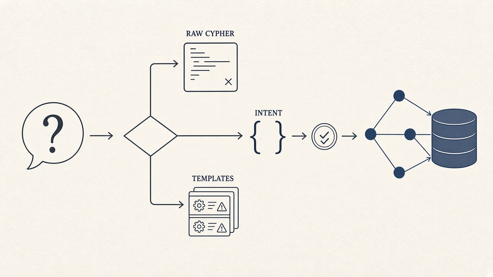

# The Graph AI Dilemma: Let LLMs Write Cypher or Suffer Template Maintenance Hell? (Ontographia Part 1)

> **Series overview: Ontographia**
>
> Business teams want to ask a graph database (for example Neo4j) questions in ordinary language. The usual choices are risky: let an AI write the database query itself, or lock the system to a fixed list of hand-written query templates.
>
> This three-part series looks at the common middle ground (AI picks a pre-approved template) and why it still stalls in production. It then proposes a different split: the AI only describes *what* the user wants to know, and a fixed, ontology-checked pipeline turns that description into a safe query ([Ontographia](https://github.com/edgesentry/ontographia)).
>
> * **Part 1: The Graph AI Dilemma** *(This article)*. Why templates become the bottleneck, what recent research helps, and the Intent-first idea
> * **Part 2: [The LLM Never Writes Cypher](https://www.linkedin.com/pulse/llm-never-writes-cypher-intent-first-design-part-2-yohei-onishi-oyroc/)**. How the split works in practice; step-by-step walkthroughs stay in the docs and repo
> * **Part 3: Wrong but Real**. Measurements on large ontologies and public datasets, plus what is still open
>
> * Documentation: [edgesentry.github.io/ontographia](https://edgesentry.github.io/ontographia/)
> * Repository: [github.com/edgesentry/ontographia](https://github.com/edgesentry/ontographia)

---

Enterprise knowledge graphs (manufacturing bills of materials, multi-tier supply chains, quality and asset data) are built around relationships. Business teams increasingly want to ask those graphs questions in plain language.

Letting an AI write the database query from scratch is hard to approve in governed environments. The model can invent names that are not in the schema, produce broken queries, mix filter values into the query text in ways that are hard to audit, or trigger expensive full-graph scans that hurt a shared database.

So many teams pick a hybrid. Engineers write pre-approved, parameterized query templates, register them as agent tools, and ask the model to choose the right template and fill in the parameters. That looks like a safe compromise at first. Over months, the pain moves: less "will the model invent a bad query?" and more "we cannot keep writing, reviewing, and regression-testing templates forever."

Here is why that hybrid hits a maintenance wall, what recent Neo4j and NLP research still assumes, and a different hypothesis: keep the AI on structured intent only, and compile the actual query with a deterministic, ontology-constrained pipeline.

## Three choices teams actually make

Teams usually land somewhere on this spectrum.

**Let the model write the query.** High flexibility. Weak guarantees. The model sees the schema (or a large dump of it) and invents a full query. Demos look great. Production risk is high: wrong or misspelled names, intermittent syntax failures, hard-to-govern string concatenation, and runaway graph scans.

**Only hand-written queries.** Maximum safety and auditability. Almost no natural-language agility. Every new nuance needs another endpoint. The product starts to feel like forms and dropdowns with an AI label.

**Hybrid: agent skills plus templates.** Engineers maintain a catalog of vetted templates. The model classifies the user's question into one of them and extracts arguments. The app binds those arguments safely and runs the query. Syntax errors drop, and tool choice is a task modern models handle well. That is why the hybrid feels like a win early on.

## Why templates become the wall

In the hybrid, flexibility is counted in templates. A few examples from a supply-chain setting:

* "Who is the primary supplier of Component A?" → template 1
* "Expand secondary suppliers for Component A." → template 2
* "List suppliers of Component A at domestic plants." → template 3
* "Which SKUs break if Supplier X stops?" → template 4

Users combine filters, path depth, aggregations, and sort orders in ways catalogs never finish covering. Each unexpected phrasing becomes another engineering ticket: "please add a template."

Schemas also change. Labels rename, junction nodes appear, properties split. One schema change can mean auditing many templates, rewriting them, updating tool descriptions so the model still picks the right one, and re-running classification tests.

The hybrid does not remove the core tension. It moves friction from model risk at runtime to human template authoring and regression cost.

## What recent research helps, and what it still assumes

The Neo4j and broader Text-to-query community has been working the same tension. Three lines matter for this series.

**Schema filtering.** Large schemas in the prompt hurt attention and raise misclassification. Approaches that prune the schema before prompting (exact match, named-entity cues, similarity) reduce that load. Key source: Ozsoy (2025), [Enhancing Text2Cypher with Schema Filtering](https://arxiv.org/abs/2505.05118).

**Iterative refinement.** One-shot generation is weak for multi-hop questions. Checkers, formal verifiers, and database feedback drive a verify-and-correct loop. Key source: Neo4j Developer Blog (2025), [Explore iterative refinement for Text2Cypher](https://neo4j.com/blog/developer/iterative-refinement-for-text2cypher/).

**Difficulty-adaptive spend.** Not every question deserves the same compute. Easy questions get a cheap pass; hard ones get more context and retries. Sources include [Wang et al. (NAACL 2025 Findings)](https://aclanthology.org/2025.findings-naacl.383/) and [Damani et al. (ICLR 2025)](https://arxiv.org/abs/2410.04707).

These ideas are useful. They still share a starting assumption: the model writes the query string. Post-check loops then struggle with three structural issues.

1. **Silent false positives.** A query can be syntactically fine, match the schema, and run without error while following the wrong business path or aggregating the wrong fields. Formal checkers do not see unspoken business rules.
2. **Filter values mixed into query text.** That complicates strict parameter binding and security review.
3. **Unstable query shape over time.** The same question can produce different query structures on different runs, which makes performance and compliance review harder.

Filtering and repair on top of unconstrained generation are helpful treatments. They are not a full architectural answer for environments that need both language flexibility and deterministic queries.

## How the options compare on what enterprises care about

**Hand-written queries only:** almost no language agility; strong safety and auditability; maintenance grows with each business question pattern.

**Model writes the query:** high agility; fragile safety; frequent schema invention; ongoing prompt and guardrail work; weak auditability.

**Hybrid templates:** agility capped by the catalog; strong safety inside approved templates; maintenance dominated by template growth and regression.

**Research overlays (filtering + refinement):** higher agility; safety depends on after-the-fact checks; silent false positives remain; more moving parts to operate.

**Intent-first (Ontographia, proposed here):** the model only fills a structured description of the question; names must exist in the ontology; the query string is produced by a fixed compiler with values bound as parameters; teams maintain the ontology rather than a growing template catalog. Details of that pipeline are in Part 2 and in the [architecture guide](https://edgesentry.github.io/ontographia/architecture/).

What those environments need at once:

1. Remove the failure modes that come from letting the model invent query text (invented names, syntax failures, injection-prone string building, runaway scans).
2. Remove the exponential template maintenance that makes the hybrid stop scaling.

## The Intent-first hypothesis

The idea is to separate *what the user wants to know* from *how the database query is assembled*.

**Application layer (where the model lives).** The user asks in natural language. The model outputs a structured Intent: which concepts to start from, which relationships to follow, which filters apply, and what to return. It does not write the database query.

**Core layer (fixed rules).** Every name in that Intent is checked against a Canonical Ontology, the single vocabulary source of truth. Unknown vocabulary is rejected. A validated Intent is lowered into an internal query structure and emitted as parameterized Cypher. The same ontology, Intent, and dialect always produce the same query text and parameter map. The application then runs that against Neo4j.

Four design principles follow.

1. **The model only extracts Intent.** Its job is mapping language into a closed, structured form, not inventing query syntax.
2. **The ontology is the gate.** Class, relationship, and property names must exist in the registered ontology before any query is built.
3. **Query text is compiled, not sampled.** Filter values travel as parameters, which removes a common injection path.
4. **Research ideas move to the Intent boundary.** Schema filtering becomes sending a smaller ontology slice with the prompt. Iterative refinement becomes revising the Intent after execution feedback, then validating and compiling again. Difficulty-adaptive spend becomes spending more retries only when early attempts fail. Part 2 and Part 3 take these up in turn.

Under this split, new questions that stay inside the ontology's vocabulary do not each need a new template. The database never sees model-written query text.

## What Parts 2 and 3 cover

* **Part 2**. How the layers are split, why the model and database driver stay outside the core, how the three research ideas map onto Intent handling, and what a small real end-to-end run showed. Implementation detail lives in the docs and repo, not in the article body.
* **Part 3**. Stress tests on ontologies with hundreds to thousands of properties (including the silent false-positive case), public Neo4j benchmark schemas, measured token and accuracy effects of subsetting, and an honest list of what the numbers do not prove.

## Takeaways

* Raw "model writes the query" is hard to govern; hand-written-only is too rigid for natural language.
* The popular hybrid moves the bottleneck to template authoring and regression.
* Schema filtering and iterative repair help, but while the model still writes query text, silent wrong-but-valid results remain.
* Intent-first keeps language flexibility in a structured description and keeps query assembly deterministic and ontology-checked.

If you want the mechanism next, continue to Part 2. If you want the measurements, skip to Part 3. To try the open-source project, start at the [documentation](https://edgesentry.github.io/ontographia/) or the [repository](https://github.com/edgesentry/ontographia).

---

*Open source project:* [github.com/edgesentry/ontographia](https://github.com/edgesentry/ontographia)
*Documentation:* [edgesentry.github.io/ontographia](https://edgesentry.github.io/ontographia/)
*Author:* Yohei Onishi
*Tags:* `#Neo4j #Cypher #KnowledgeGraph #GraphRAG #AIAgents #EnterpriseAI #DataEngineering`
