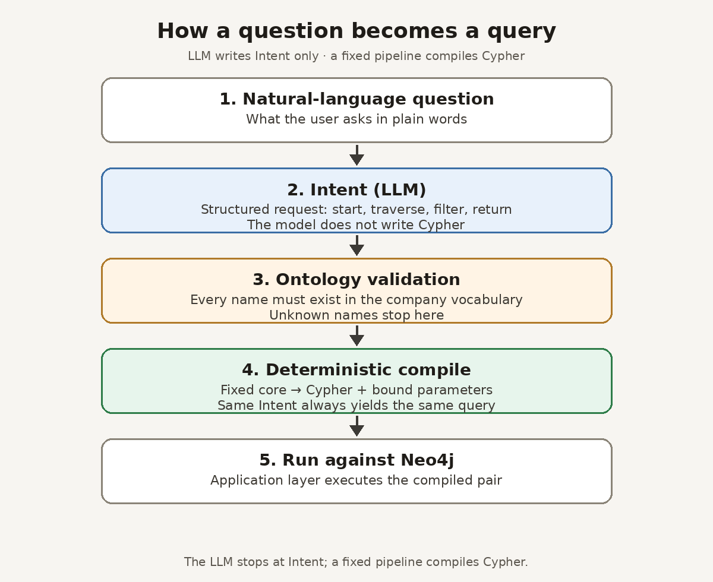

# The LLM Never Writes Cypher: Intent-First Design and Implementation (Ontographia Part 2)

> **Series overview: Ontographia**
>
> Teams that query a graph database such as Neo4j in natural language usually choose between letting an AI write the query and locking the system to handwritten templates. This series examines the common compromise (agent skills plus template selection) and proposes another split: the AI extracts a structured Intent, and an ontology-checked, deterministic pipeline compiles the Cypher ([Ontographia](https://github.com/edgesentry/ontographia)).
>
> * **Part 1: [The Graph AI Dilemma: Let LLMs Write Cypher or Suffer Template Maintenance Hell?](https://www.linkedin.com/pulse/graph-ai-dilemma-let-llms-write-cypher-suffer-template-yohei-onishi-hj8kc/)**. Production bottlenecks, research review, Intent-first hypothesis
> * **Part 2: The LLM Never Writes Cypher** *(This article)*. How the split works in practice
> * **Part 3: Wrong but Real**. Stress tests, public datasets, and limits of the claims
>
> * Documentation: [edgesentry.github.io/ontographia](https://edgesentry.github.io/ontographia/)
> * Repository: [github.com/edgesentry/ontographia](https://github.com/edgesentry/ontographia)

---

Part 1 ended with a question. Can a natural-language interface follow what users actually ask, and still produce database queries that are deterministic and auditable, without engineering work growing with every new template?

Ontographia's answer is to give the AI exactly one job. It reads the question and writes a structured Intent: where to start, which relationships to follow, how to filter, and what to return. A fixed core checks every name in that Intent against the ontology and compiles it into Cypher with values bound as parameters. The AI never writes Cypher, and nothing it writes reaches the database as query text.

The published packages already follow that split. [v0.1.5](https://github.com/edgesentry/ontographia/releases/tag/v0.1.5) started rejecting Intents with unknown fields. [v0.1.6](https://github.com/edgesentry/ontographia/releases/tag/v0.1.6) packaged the experimental Intent layer as an installable extra and added an MCP server that builds Cypher only after validation. Later sections walk through that design and a small end-to-end run of v0.1.6 against a real Neo4j setup.

The rest of this piece stays at design level: how a question becomes a query, why the template catalog can go away, why the model and database driver stay outside the core, and how three research ideas move from "fix the query string" to "fix the Intent." Step-by-step implementation belongs in the public docs and repo, linked below.

## Where Part 1 left off

In [Part 1](https://www.linkedin.com/pulse/graph-ai-dilemma-let-llms-write-cypher-suffer-template-yohei-onishi-hj8kc/) I argued that the template-selection hybrid looks safe but hits a structural wall. Flexibility is counted in templates, so every new kind of question means another template to write, review, and regression-test. Research such as schema filtering and iterative refinement helps, but it usually repairs queries after the fact and still assumes the model writes raw Cypher.

Ontographia moves flexibility into the Intent and keeps query assembly deterministic. Only Intents that pass ontology validation are compiled. Prompting, model calls, and database execution live outside the core, in the application or agent layer. The [architecture guide](https://edgesentry.github.io/ontographia/architecture/) describes the boundary in detail.

## How a question becomes a query

The LLM does not write Cypher. It writes a structured Intent; a deterministic pipeline validates that Intent against the ontology and compiles the query.

In plain terms the path is:

1. Load the company's ontology (YAML, Turtle, or another supported form) into an internal Canonical Ontology Model. That model is the vocabulary source of truth.
2. Give the model a schema derived from that vocabulary and ask for a structured Intent as output (start, traverse, filter, return). The model stops there; it does not emit Cypher.
3. Validate every class, relationship, and property name in the Intent. Unknown names stop here; the error goes back so the model can retry.
4. Compile a validated Intent into a `{ query, params }` pair. The same ontology, Intent, and dialect always produce the same pair. Filter values travel in the parameter map, not inside the query text.
5. Run that pair against Neo4j in the application layer.

A manufacturing sample in the repository asks for suppliers of the parts that make up a product SKU. The Intent names the start concept, the relationships to walk, the SKU filter, and the supplier name to return. The compiled query binds the SKU as a parameter so the literal never appears in the query string. To see the exact Intent shape and emitted Cypher, use the [Neo4j end-to-end walkthrough](https://edgesentry.github.io/ontographia/end-to-end-neo4j/) and the samples under the repository rather than treating this article as an implementation guide.

## Why the template catalog can go away

In the hybrid approach, someone writes a Cypher string in advance for each pattern: one for a supplier list, another for a recursive bill-of-materials expansion, and so on.

In Ontographia a query is a combination of a small set of Intent fields (start, traverse, filter, return, plus optional ordering, paging, and an optional-match flag). Any question that stays inside the ontology's vocabulary can be expressed with those fields, so a new pattern does not need a new template.

The field set is closed. Since [v0.1.5](https://github.com/edgesentry/ontographia/releases/tag/v0.1.5), an unknown key is a validation error that names the offending field. Before that, unknown keys were ignored, so a model that wrote `filters` instead of `filter` could build a query with the filter silently dropped. Unknown dialect names are rejected the same way instead of falling back quietly.

## Why the core has no model and no database driver

The core is a compiler. It has no networking, no model API, and no Neo4j driver. Many AI toolkits put those inside the engine; Ontographia keeps them out on purpose so query assembly can be tested without tokens, without mocked model replies, and without a live database. The rule that the model never edits Cypher is enforced by that boundary, not only by convention. See the [architecture guide](https://edgesentry.github.io/ontographia/architecture/).

Leaving prompting and execution to the application has a cost: every team would otherwise invent its own wiring. The project started with helpers as examples in the repository. In [v0.1.6](https://github.com/edgesentry/ontographia/releases/tag/v0.1.6) they became an installable, experimental Python extra for Intent extraction and related loops. Cypher still comes only from the core, after validation.

## Three research ideas, moved from Cypher to Intent

Part 1 covered schema filtering, iterative refinement, and difficulty-adaptive spend. Those lines usually assume the model writes Cypher. The Intent layer applies the same ideas one step earlier.

**Schema filtering becomes ontology subsetting.** Large enterprise ontologies can have hundreds or thousands of classes and properties. Putting all of them in the prompt costs tokens and makes it easier for the model to pick a property that looks right but is not. The Intent layer matches words in the question against ontology names (ignoring case and normalizing plurals), adds the minimal relationships that connect the matched classes, and sends only that subset. If extraction or validation fails on the subset, it retries with the full schema. If nothing matches, it uses the full schema from the start.

**Iterative refinement becomes Intent repair.** An Intent can pass validation, compile, and still return zero rows, or the driver can raise a type error. Text-to-Cypher work often hands the failed Cypher back to the model, which brings non-determinism back into the query string. Here the model gets the execution result and revises the Intent. The revised Intent goes through validation and compilation again, so every query that runs still comes from the compiler. The loop is opt-in, defaults to at most two rounds, and stops if a revised Intent fails validation.

**Difficulty-adaptive spend becomes staged retries.** Everyday questions are often single-node lookups or shallow walks. Extraction starts with the subset and a single retry, and only then moves to the full schema with more retries. Execution failures on Neo4j do not trigger that escalation; the repair loop handles those. The aim is lower tokens and latency on easy questions. Whether it works is a measurement question; Part 3 has the numbers.

## What changes for agent skills

With Intent-first, agent skills have less to do. In the hybrid, the model classifies which template to call, and developers maintain a growing catalog. Here the model turns a question into an Intent, and developers maintain the ontology and the extraction prompt.

Schema changes show the difference most clearly. In the hybrid, renaming a property means finding every affected template, fixing it, and re-testing classification. In Ontographia you update the ontology and validation follows it. Query safety stops depending on whoever wrote each template, because names are checked and values are bound before any query string exists.

## v0.1.6 in practice: MCP and a small end-to-end run

v0.1.6 also added an experimental MCP (Model Context Protocol) server with tools to list the ontology, expose the Intent schema, build Cypher from an Intent, and execute. The server does not call a model. The MCP client supplies the Intent; the server validates before building Cypher, so the model still never writes Cypher when it runs inside an MCP client. Setup is in the [MCP docs](https://edgesentry.github.io/ontographia/mcp/).

Those tools worked against a real setup in my checks, including replaying a saved Intent through build and execute. Integration tests for execute also run in CI against a live Neo4j instance.

Separately, I ran questions end to end with Gemini 3.7 Flash and a local Neo4j. When the model put a property name that does not exist in the ontology into an Intent (for example a garbled name with a stray character between `name` and `as_name`), validation failed, no Cypher was emitted, and the bad name never reached the database.

Answering the question was a different matter. I kept all four attempts, and only one succeeded end to end; that one returned two rows, MikroMotors and FormTech. Stopping a bad name and answering correctly are separate results, and in this small sample the second rate is low.

The protection is also narrow. Validation stops names that are not in the ontology. If the model picks a real name that is the wrong one for the question, the Intent passes; Part 1 called these silent false positives. Factual errors are out of scope too. This is not a claim that Ontographia prevents hallucination in general.

## Known limits

Intent-first covers questions that fit the ontology's vocabulary. A question that needs a class or relationship the ontology does not define fails validation instead of producing a query.

The project is pre-1.0, and releases can still break compatibility; v0.1.5 started rejecting Intents with unknown keys that earlier versions built. The Intent layer and the MCP server are experimental optional extras. Subsetting, adaptive retries, and execution feedback live there, not in the core compiler. GQL output is a prototype. The [roadmap](https://github.com/edgesentry/ontographia/blob/main/docs/roadmap.md) lists what comes next, without dates.

## Next: does it hold up at scale?

Moving natural-language flexibility into the Intent and making Cypher assembly deterministic means a new kind of question no longer needs a new template. Whether that holds against ontologies with thousands of properties and public Text-to-Cypher benchmarks is a separate question. Part 3 reports a stress test at that scale and validation on public datasets, including where the approach falls short, plus a re-run on the published v0.1.6 package with two model versions.

To try it: install the core with `pip install ontographia`, and add the experimental Intent layer or MCP extras if you need them (`ontographia[llm]`, `ontographia[mcp]`). The CLI is also on Homebrew (`brew tap edgesentry/tap && brew install ontographia`). The [Neo4j walkthrough](https://edgesentry.github.io/ontographia/end-to-end-neo4j/) runs the manufacturing sample end to end. If you try it on your own ontology, I would like to hear which questions failed validation and which passed but returned the wrong thing; issues are open on the [repository](https://github.com/edgesentry/ontographia).

---

*Open source project:* [github.com/edgesentry/ontographia](https://github.com/edgesentry/ontographia)
*Documentation:* [edgesentry.github.io/ontographia](https://edgesentry.github.io/ontographia/)
*Release notes:* [v0.1.5](https://github.com/edgesentry/ontographia/releases/tag/v0.1.5), [v0.1.6](https://github.com/edgesentry/ontographia/releases/tag/v0.1.6)
*Author:* Yohei Onishi
*Tags:* `#Neo4j #Cypher #KnowledgeGraph #GraphRAG #AIAgents #EnterpriseAI #MCP`
