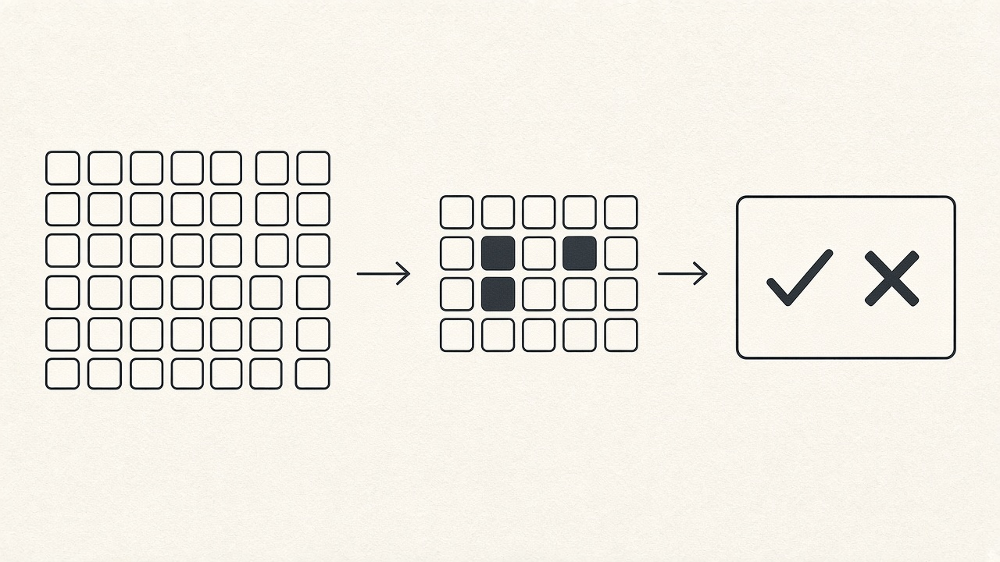

# Wrong but Real: Evaluating Intent-First Cypher Generation at 2,000 Properties (Ontographia Part 3)



> **Series overview: Ontographia**
>
> Teams that query a graph database such as Neo4j in natural language usually choose between letting an AI write the query and locking the system to handwritten templates. This series examines the common compromise (agent skills plus template selection) and proposes another split: the AI extracts a structured Intent, and an ontology-checked, deterministic pipeline compiles the Cypher ([Ontographia](https://github.com/edgesentry/ontographia)).
>
> * **Part 1: [The Graph AI Dilemma: Let LLMs Write Cypher or Suffer Template Maintenance Hell?](https://www.linkedin.com/pulse/graph-ai-dilemma-let-llms-write-cypher-suffer-template-yohei-onishi-hj8kc/)**. Production bottlenecks, research review, Intent-first hypothesis
> * **Part 2: [The LLM Never Writes Cypher: Intent-First Design and Implementation](https://www.linkedin.com/pulse/llm-never-writes-cypher-intent-first-design-part-2-yohei-onishi-oyroc/)**. How the split works in practice
> * **Part 3: Evaluation and Roadmap** *(This article)*. What the measurements support, what they do not, and what comes next
> * Japanese edition: [Zenn article](https://zenn.dev/yohei/articles/2026-09-08-ontographia-eval-and-roadmap)
>
> * Documentation: [edgesentry.github.io/ontographia](https://edgesentry.github.io/ontographia/)
> * Repository: [github.com/edgesentry/ontographia](https://github.com/edgesentry/ontographia)

---

## Executive Summary: What This Evaluation Answers

In Part 1, I laid out why the standard compromise in graph AI—agent skills paired with template selection—hits a maintenance ceiling as schemas expand, and proposed the Intent-first hypothesis. In Part 2, I walked through the architecture that enforces this division of labor: the model extracts an Intent JSON payload, and a deterministic core validates it against an ontology and builds parameter-bound Cypher. Part 2 also adapted three major directions from recent Text-to-Cypher literature to the Intent layer: dynamic ontology subsetting, self-repair driven by execution feedback, and difficulty-adaptive resource allocation.

This final installment examines whether the Intent-first architecture holds up under stress, where it succeeds, and where its limits lie. To answer those questions, I tested the system across a synthetic manufacturing stress benchmark of up to 2,000 properties and 15 third-party public database schemas from Neo4j's official text2cypher benchmark.

Before digging into the full data, here are the five primary takeaways from the evaluation:

First, static ontology validation breaks down against silent false positives as schemas grow. When an ontology contains thousands of properties, an LLM easily picks a distractor that exists in the schema but is wrong for the question (such as picking factory_id instead of plant_id). Because the chosen property is a real, registered vocabulary item, static schema validators and AST compilers accept it without error. The query compiles cleanly, runs without failing, and returns wrong numbers.

Second, dynamic ontology subsetting structurally resolves this silent failure mode. By extracting a minimal connected subgraph of classes and relationships matched to the user's question, irrelevant distractors are physically pruned from the prompt. In deterministic simulation, this raised property accuracy by 50 percentage points and cut prompt tokens by about 91%. In live repeated evaluations using Gemini 3.8 Flash on a 2,000-property ontology, our recommended subset-with-fallback policy lifted property accuracy by an average of 19.5 percentage points over the full schema while cutting prompt tokens by roughly 90.5% to 91% (13,765 down to 1,301 p95).

Third, execution feedback repairs empty results without compromising query governance. When a query is syntactically valid but returns zero rows because of an invalid filter value (an Empty@Valid condition), feeding the empty execution result back into an Intent revision prompt achieved 100% task recovery in deterministic simulation. Crucially, the model never touches raw Cypher strings; all regenerated queries matched the deterministic compiler output exactly.

Fourth, difficulty-adaptive resource allocation drastically reduces operational total cost of ownership. For routine questions, a subset-first policy with a single initial attempt matched the quality of an always-full-schema baseline while trimming token consumption by about 91%. For challenging questions where the subset pruned necessary vocabulary, the pipeline automatically escalated to the full schema with extended retries, recovering cleanly without human intervention.

Fifth, third-party schemas integrate smoothly, but public benchmark answer quality highlights fundamental evaluation constraints. All 15 external schemas from Neo4j's text2cypher benchmark converted into Ontographia's Canonical Ontology Model, achieving 100% relationship coverage, about 96% node label coverage, and about 81% property coverage. However, an end-to-end execution spot check on live public demo databases scored an exact row-set match of roughly 3%. Because public benchmarks treat raw Cypher as the gold standard rather than Intent structures, semantically valid Cypher queries written differently from the benchmark reference are penalized as total failures.

---

## The Evaluation Framework: Why, Value, and How

Before reviewing the numerical data, it helps to establish the experimental logic: why each test was necessary, what concrete value it delivers to operational teams, and why specific evaluation techniques were chosen.

The evaluation is split across two experimental tracks:

Track A is a synthetic stress test based on an enterprise manufacturing domain. It introduces controlled distractor properties across three scale tiers (16, 200, and 2,000 properties) to stress-test hypotheses H1, H2, and H3 under isolated conditions.

Track B is an external validity benchmark using 15 third-party database schemas published by Neo4j, spanning cinema, social networks, healthcare, and retail. It evaluates whether Ontographia's Canonical Ontology Model generalizes beyond schemas authored by its creators.

### Why Evaluate? Motivations and Failure Modes

The primary motivation for this evaluation was the realization that the common belief—"constraining an LLM with an ontology guarantees query safety"—is flawed.

Static ontology validation cleanly rejects hallucinated vocabulary that does not exist in the database. But when an enterprise ontology swells to thousands of properties after years of system integrations, mergers, and ERP migrations, it fills with plausible near-duplicates. If an LLM selects an incorrect property that happens to be registered in the schema, mechanical validation passes it through. The failure is completely silent.

A second motivation was validating self-repair. When a query compiles cleanly but returns zero rows because a filter value does not exist, can an agent recover simply by correcting its structured Intent, without letting the model edit raw Cypher text directly?

A third motivation was verifying architectural generality. Any developer can build an abstraction that works on their own demo schema. Demonstrating that the pipeline functions across 15 external database models without modification was necessary to prove that the Canonical Ontology Model is not an overfitted toy.

### What Value Does It Deliver? Operational Benefits

For teams running graph databases in production, these verifications address real economic and operational bottlenecks:

* Substantial Cost and Latency Reductions (H1): Trimming prompt tokens by roughly 91% (p95 dropped from 13,765 to 1,301 tokens on a 2,000-property schema) dramatically lowers commercial LLM API expenses and speeds up response times.
* Structural Immunity to Silent False Positives (H1): Pruning irrelevant distractor properties from the prompt physically prevents the model from choosing them.
* Reconciling Governance with Task Completion (H2): Agents can self-heal from empty queries without opening the security risks and nondeterminism of raw Cypher generation.
* Lowering Total Cost of Ownership Across Mixed Workloads (H3): Routine questions are answered quickly with minimal context, while complex edge cases automatically receive deeper reasoning budgets and full schema context.
* Broad Domain Portability (Track B): Teams can apply the engine across diverse operational domains without custom compiler re-engineering.

### How Was It Measured? Experimental Rigor and Boundaries

To ensure that results reflect real architectural properties rather than random benchmark noise, the evaluation balances synthetic isolation with real-world testing:

Why use a synthetic benchmark for Track A?
In production datasets, failure causes are heavily confounded by missing data, inconsistent terminology, ambiguous questions, and network timeouts. By synthesizing near-duplicate distractors across three distinct scale milestones (16, 200, and 2,000 properties), we can cleanly isolate exactly how schema size distorts model attention and triggers silent false positives.

Why use public benchmarks for Track B?
Testing against 15 third-party schemas from Neo4j's official text2cypher-2025v1 dataset eliminates author bias and proves that the ontology ingestion engine handles diverse graph designs.

Why use deterministic simulation arms?
In clinical trials and statistics, an "arm" refers to a distinct experimental condition group. In our evaluation, a "deterministic simulation arm" replaces the commercial LLM with fixed, predictable heuristic rules.

Commercial LLMs introduce nondeterministic variance, daily API updates, rate limits, and sampling noise. If an evaluation mixes pipeline mechanics with live LLM calls from day one, it becomes impossible to determine whether a failure was caused by a bug in the state machine or a temporary lapse in model attention.

Just as software engineers separate unit and integration tests from third-party API dependencies, using deterministic simulation arms allows us to verify the correctness of the pipeline control loops with 100% mathematical reproducibility.

However, a deterministic simulation tests the mechanics of the control pipeline, not the intelligence of a model. To verify how real models perform, we follow simulation testing with repeated live commercial LLM evaluations using Gemini 3.8 Flash.

---

## 1. Three Core Hypotheses and Pre-Registered Pass Criteria

To evaluate the architectural extensions proposed in Part 2, I established three formal hypotheses. To prevent post-hoc rationalization, strict pass, partial, and fail criteria were defined directly in the evaluation harness code before running benchmarks.

### Hypothesis H1: Dynamic Ontology Subsetting

* Premise: In large-scale ontologies, providing an LLM with a dynamically pruned ontology subset based on question vocabulary yields higher property extraction accuracy and drastically lower token usage than providing the full schema.
* Practical Value: Drastically reduces API costs and response latency while structurally blocking distractor properties from model context.
* Implementation: Dynamic ontology subsetting via graph traversal and lexical matching, paired with an optional fallback to the full schema.
* Pre-Registered Criteria:
  * Supported: On the 2,000-property ontology, Property Hit rate exceeds the full schema by at least 10 percentage points, prompt token consumption at p95 drops by at least 30%, and compile success rate does not degrade.
  * Partially Supported: Prompt token consumption drops by at least 30%, but property extraction accuracy remains roughly identical.
  * Not Supported: Subsetting strips necessary vocabulary, causing compile rates or property accuracy to drop significantly below the full schema baseline.

### Hypothesis H2: Intent Repair via Execution Feedback

* Premise: When an Intent compiles cleanly but returns zero rows or encounters runtime execution errors, feeding execution feedback into an Intent revision prompt allows the agent to self-heal and improve final task completion.
* Practical Value: Preserves the deterministic AST compiler invariant—the LLM never writes or edits Cypher—while allowing agents to recover from empty database responses.
* Implementation: Execution feedback loop enabled via the `--refine-on-exec` flag.
* Pre-Registered Criteria:
  * Supported: Across a zero-result test suite, enabling execution feedback improves final execution success by at least 20 percentage points, recovers Intent exact match, and ensures 100% of emitted Cypher queries match the deterministic compiler output.
  * Partially Supported: Final execution success improves, but the gain is under 20 percentage points.
  * Not Supported: Execution feedback fails to improve final execution success, or introduces invalid query syntax.

### Hypothesis H3: Difficulty-Adaptive Cost Allocation

* Premise: Routing simple questions to an ontology subset with minimal retries, while reserving the full schema and extended retries for difficult questions, preserves answer quality while slashing overall token spend.
* Practical Value: Minimizes enterprise operational TCO by tailoring compute budgets to query complexity.
* Implementation: Adaptive schema policy (`--schema-policy auto`) with initial and escalated retry ceilings.
* Pre-Registered Criteria:
  * Supported: On the 2,000-property ontology, prompt token consumption at p95 on easy questions drops by at least 30% compared to an always-full baseline while maintaining identical LLM call counts, compile rates, and property accuracy, while hard questions automatically escalate to the full schema and recover.
  * Partially Supported: Token consumption drops, but accuracy exhibits instability across query subsets.
  * Not Supported: Adaptive allocation degrades query accuracy or fails to reduce token consumption.

---

## 2. Track A: Reproducing Silent False Positives at Scale

### The Experimental Setup

In enterprise knowledge graphs, property namespaces frequently become polluted. A manufacturing database might simultaneously contain `plant_id`, `plant_code`, `factory_id`, `facility_name`, and `plant_name`.

To measure how schema growth impacts model behavior, Track A uses a manufacturing ontology evaluated against 40 benchmark questions, each associated with an authoritative Gold Intent. We synthesized three scale tiers by systematically injecting distractors—near-duplicate property names and redundant entity types:

* Small: 16 properties (clean, minimal schema without artificial distractors).
* Mid: 200 properties (moderate schema containing realistic enterprise near-duplicates).
* Large: 2,000 properties (dense, large-scale enterprise schema heavily populated with distractors).

The test suite evaluates what happens when an Intent contains an incorrect property that nonetheless exists within the ontology.

### Baseline Results on the Full Schema

Running the baseline pipeline across all three schema tiers produced the following results:

* Small Schema (16 properties):
  * Gold Intent compile rate: 40 of 40 (100%).
  * Silent false positive compile rate: 0 of 40 (0%).
  * Silent false positives detected as unknown vocabulary: 40 of 40 (100%).
  * Full schema prompt tokens: 1,359 tokens.
  * Subset schema prompt tokens: 1,246 tokens.

* Mid Schema (200 properties):
  * Gold Intent compile rate: 40 of 40 (100%).
  * Silent false positive compile rate: 40 of 40 (100%).
  * Silent false positives detected as unknown vocabulary: 0 of 40 (0%).
  * Full schema prompt tokens: 2,460 tokens.
  * Subset schema prompt tokens: 1,247 tokens.

* Large Schema (2,000 properties):
  * Gold Intent compile rate: 40 of 40 (100%).
  * Silent false positive compile rate: 40 of 40 (100%).
  * Silent false positives detected as unknown vocabulary: 0 of 40 (0%).
  * Full schema prompt tokens: 13,710 tokens.
  * Subset schema prompt tokens: 1,247 tokens.

### What This Means: The Mechanism of Silent Failure

On the clean 16-property schema, the system performed as intuitively expected: because distractor properties did not exist in the ontology, any Intent attempting to use an incorrect property was rejected by static validation as an unknown name.

However, once the schema grew to 200 and 2,000 properties, the safety net vanished. All 40 deliberately incorrect Intents sailed through ontology validation and compiled into executable Cypher (40 of 40).

This quantitatively confirms the primary failure mode of graph AI at scale: static validators and AST compilers verify lexical existence, not contextual appropriateness. If an LLM becomes confused by a wall of prompt text and selects `factory_id` instead of `plant_id`, the validator sees a registered, valid attribute and signs off on the query. The database executes it without raising an error, producing empty rows or corrupt business metrics.

Simultaneously, prompt token overhead on the full schema grew tenfold, jumping from 1,359 tokens on the small schema to 13,710 tokens on the large schema.

To reproduce this baseline experiment locally:
```bash
uv run python examples/llm/eval/run_track_a.py --record
```

---

## 3. Hypothesis H1 in Deterministic Simulation

### Pruning the Vocabulary Space

To combat both silent false positives and prompt bloat, Ontographia implements dynamic ontology subsetting. When a user asks a question, the engine scans the text for vocabulary matching ontology classes and properties. It identifies the target nodes, computes the minimal connecting relationships between them, and prunes all unreferenced entities and distractor properties from the prompt.

We evaluated three schema delivery configurations on the 2,000-property ontology:

1. Full Schema: The entire 2,000-property ontology is serialized into the model prompt.
2. Standalone Subset: Only the dynamically pruned subgraph is provided.
3. Subset with Fallback (`subset_fallback`): The model receives the subset first; if Intent extraction or validation fails, the engine automatically falls back to the full schema. This is our recommended production configuration.

### Simulation Results at 2,000 Properties

Testing these configurations in a deterministic simulation arm yielded the following measurements:

* Full Schema:
  * Property Hit rate: 0.50
  * Compile success rate: 40 of 40 (100%)
  * Distractor properties exposed in prompt: 40
  * Induced incorrect choices: 40
  * Fallback invocation rate: 0%
  * Prompt tokens at p95: 13,710 tokens

* Standalone Subset:
  * Property Hit rate: 1.00 (+50 percentage point improvement)
  * Compile success rate: 40 of 40 (100%)
  * Distractor properties exposed in prompt: 0
  * Induced incorrect choices: 0
  * Fallback invocation rate: 0%
  * Prompt tokens at p95: 1,247 tokens (roughly 91% reduction)

* Subset with Fallback:
  * Property Hit rate: 1.00 (+50 percentage point improvement)
  * Compile success rate: 40 of 40 (100%)
  * Distractor properties exposed in prompt: 0
  * Induced incorrect choices: 0
  * Fallback invocation rate: 0%
  * Prompt tokens at p95: 1,247 tokens (roughly 91% reduction)

### Simulation Verdict: Supported

The simulation arm met all pre-registered criteria for Hypothesis H1:
* Property accuracy jumped from 0.50 to 1.00. Because distractors were physically absent from the prompt, the model could not be misled by them.
* Prompt tokens at p95 dropped from 13,710 to 1,247, achieving a 90.9% reduction.
* Compile success remained at 40 of 40.
* In this clean benchmark fixture, the fallback rate remained at 0% because all necessary vocabulary was captured in the initial subset.

However, a deterministic simulation relies on a key simplifying assumption: that the model only errs when distractors are visible in its prompt. To observe how real models behave when dealing with ambiguous phrasing and vocabulary pruning, we turn to commercial LLM evaluation.

To reproduce the simulation locally:
```bash
uv run python examples/llm/eval/run_track_a_h1.py --record
```

---

## 4. Live Commercial LLM Remeasurement with Gemini 3.8 Flash

### Experimental Protocol and Sampling Design

To measure real-world performance, we evaluated the published package (`ontographia[llm]==0.1.6`) against commercial LLM APIs via LiteLLM. We selected Gemini 3.8 Flash (model identifier `ontographia-gemini-3.8`, temperature 0).

Because commercial LLM calls are subject to sampling variance, single-run benchmarks can be deeply misleading. We designed a multi-run sampling plan across both the 200-property (mid) and 2,000-property (large) schemas:
* Mid profile (200 properties): Evaluated across 3 complete runs (mid n=3).
* Large profile (2,000 properties): Initial evaluations revealed noticeable trial-to-trial variance in the standalone subset condition. To obtain statistically rigorous estimates, we extended the large profile evaluation to 5 complete runs (large n=5, 3 initial runs plus 2 extensions).

### Large Schema Evaluation Results (2,000 Properties, n=5)

The summary below details the mean and sample standard deviation across all 5 live runs on the 2,000-property ontology:

* Full Schema:
  * Property Hit rate (mean ± sd): 0.683 ± 0.069
  * Compile success rate (mean ± sd): 28.4 ± 3.0 of 40
  * Fallback invocation rate: 0.000
  * Average LLM calls per query: 0.710
  * Prompt tokens at p95: 13,765 tokens

* Standalone Subset:
  * Property Hit rate (mean ± sd): 0.720 ± 0.086
  * Compile success rate (mean ± sd): 29.8 ± 3.7 of 40
  * Fallback invocation rate: 0.000
  * Average LLM calls per query: 0.745
  * Prompt tokens at p95: 1,301 tokens

* Subset with Fallback (Recommended):
  * Property Hit rate (mean ± sd): 0.878 ± 0.065
  * Compile success rate (mean ± sd): 36.4 ± 2.3 of 40
  * Fallback invocation rate (mean ± sd): 0.170 ± 0.027
  * Average LLM calls per query: 1.080
  * Prompt tokens at p95: 1,301 tokens

Crucially, across all 5 runs and all conditions, the rate of hallucinated vocabulary ("invent-without-seeing", where the model invents terms absent from the prompt) was exactly 0. The rate of choosing near-duplicate distractors was also 0.

### Mid Schema Reference Results (200 Properties, n=3)

For comparison, the 3 runs on the 200-property ontology produced consistent trends:

* Full Schema:
  * Property Hit rate (mean ± sd): 0.683 ± 0.031
  * Compile success rate: 29.0 of 40
  * Prompt tokens at p95: 2,515 tokens

* Standalone Subset:
  * Property Hit rate (mean ± sd): 0.717 ± 0.051
  * Compile success rate: 29.7 of 40
  * Prompt tokens at p95: 1,301 tokens

* Subset with Fallback (Recommended):
  * Property Hit rate (mean ± sd): 0.858 ± 0.038
  * Compile success rate: 36.3 of 40
  * Prompt tokens at p95: 1,301 tokens

### Empirical Analysis and Engineering Implications

Reviewing these measurements yields four critical insights:

First, Hypothesis H1 is supported under live commercial conditions. Across every single run in both the mid (n=3) and large (n=5) configurations, the pre-registered criteria were fully satisfied. The formal verdict across all runs is Support.

Second, the recommended `subset_fallback` policy demonstrates clear superiority over the full schema. On the 2,000-property ontology, `subset_fallback` boosted Property Hit rate by an average of +19.5 percentage points (improving from 0.683 to 0.878). Across the 5 individual runs, the measured accuracy gains over the full schema were +21.25, +31.25, +22.50, +11.25, and +11.25 percentage points. Clean compile completions rose from 28.4 to 36.4 of 40. Prompt tokens at p95 plunged from 13,765 down to 1,301, representing a 90.5% reduction (roughly 91%).

Third, standalone subsetting exhibits high variance and must not be used in production. While the standalone subset achieved a higher mean accuracy than the full schema (0.720 vs 0.683), its sample standard deviation was large (sd = 0.086). In individual runs, aggressive keyword pruning stripped out necessary vocabulary, causing the standalone subset to score lower than the full schema.

Fourth, the fallback mechanism is essential for operational stability. Under `subset_fallback`, the engine automatically escalates to the full schema whenever the subset fails extraction or validation. This fallback triggered on 17.0% ± 2.7% of queries, requiring an average of 1.08 LLM calls per question. By using the full schema as a safety net, `subset_fallback` recaptured missing vocabulary and maintained a high, stable success rate (0.878 ± 0.065). In production environments, subsetting without a fallback path is an anti-pattern.

To reproduce the live evaluation harness:
```bash
uv run python examples/llm/eval/run_track_a_h1_live.py --profiles mid,large --record
```

---

## 5. Track B: External Validity Across 15 Third-Party Schemas

### Overcoming Author Bias

Any architecture can achieve high benchmark scores on an ontology designed by its own authors. To test whether Ontographia's Canonical Ontology Model (COM) generalizes to third-party databases, Track B evaluates the engine against external benchmarks.

We sourced 15 database schemas from Neo4j's official [neo4j/text2cypher-2025v1](https://huggingface.co/datasets/neo4j/text2cypher-2025v1) dataset on Hugging Face. These schemas represent diverse domains, including cinema, recommendations, social networks, retail, logistics, and healthcare. We built an automated ingestion tool (`schema_convert.py`) to parse these external schemas and map them directly into Ontographia's COM structure.

### Schema Ingestion Coverage

Across all 15 third-party databases, the ingestion tool produced the following results:

* Schema conversion and `Engine.load` success rate: 15 of 15 (100%).
* Average node label coverage: approximately 96%.
* Average relationship type coverage: 100%.
* Average property coverage: approximately 81%.

### Assessing Ingestion Gaps

The engine ingested every single external database schema without code changes, achieving perfect coverage on relationship topologies and 96% coverage on node entity types.

The remaining 19% gap in property coverage stems from structural quirks in the source benchmark dataset rather than architectural limitations. Several schemas in `text2cypher-2025v1` contain inconsistent textual property descriptions, unstructured comments, or property names embedded inside freeform prose. While automated regex parsers missed these edge cases, the underlying COM schema representation accommodates all standard graph primitives.

---

## 6. Track B Exec Match Spot Check and Honest Reading

### Live Database Execution on Public Benchmarks

To evaluate whether the pipeline could answer questions on these third-party databases, we conducted an end-to-end execution spot check. We stratified 60 sample questions (seed=53) from the movies and recommendations databases, pointed the engine at Neo4j's public demo instance (`demo.neo4jlabs.com`), and queried the database using Gemini 3.7 Flash (`gemini-3.7-flash` via LiteLLM).

The pipeline executed the full cycle: Natural Language Question -> Intent JSON -> Deterministic `Engine.build` -> Neo4j Database Query -> Jaccard Row-Set Comparison against benchmark Gold Cypher queries.

The spot check yielded the following metrics:

* Compile success rate: 41 of 60 queries compiled cleanly (approximately 68%).
* Exec Match (exact row-set match against Gold Cypher): 1 of 38 executed queries (approximately 3%).
* Average Jaccard similarity across row sets: 0.03.
* Structural F1 scores:
  * Node labels: 0.82
  * Relationship types: 0.67
  * Properties: 0.61

### An Honest Assessment of Public Benchmark Limitations

An exact match score of roughly 3% is undeniably low. However, analyzing the failure modes reveals the structural challenges of evaluating Intent-first architectures against raw Cypher benchmarks:

* Benchmark Reference Queries Are Raw Cypher: In standard Text-to-Cypher benchmarks, the gold standard is an arbitrary Cypher query written by a human. The benchmark judges correctness by running both queries and verifying whether the returned row sets match identically.
* Syntactic Equivalence vs. Identity: Ontographia's deterministic AST compiler builds standardized, parameter-bound Cypher queries. For example, where a benchmark author wrote a custom nested pattern comprehension, Ontographia might generate a clean multi-step `MATCH ... WHERE` block with distinct aliasing. Both queries may extract valid operational data, but minor differences in column ordering, aggregation grouping, or projection limits cause the strict row-set Jaccard comparison to score 0.
* Compound Pipeline Errors: The 3% figure conflates Intent extraction errors, schema conversion gaps, and alternative Cypher formulations.

This experiment proves that Ontographia's ingestion and compilation pipeline executes end-to-end on arbitrary third-party databases without crashing. It does not prove that Ontographia currently matches human-level accuracy on open-domain Cypher benchmarks. We make no claims of State-of-the-Art (SOTA) execution parity on Track B.

### Generalizing Business Terminology Mappings

A key takeaway from Track B was the necessity of decoupling domain heuristics from the core engine. In early prototypes, terminology repair rules were hardcoded for manufacturing concepts. In Track B, we moved these rules into declarative YAML configuration mappings. We verified that switching from manufacturing mappings to cinema domain mappings allowed the same compiler engine to handle movies without modification.

To run the Track B execution benchmark:
```bash
uv run --with datasets --with neo4j python examples/llm/eval/run_track_b_exec.py --record
```

---

## 7. Hypothesis H2: Safe Self-Repair via Execution Feedback

### The Empty@Valid Problem

In real enterprise operations, a query can be syntactically flawless, fully compliant with the ontology, and compile without warnings, yet still return zero records when executed against the database.

Consider a user asking for production numbers from "Plant 4." The ontology confirms that `Plant` nodes have a `plant_code` attribute, and the query compiles cleanly. But if the physical database only contains plants 1, 2, and 3, Neo4j returns an empty result set. We term this failure mode Empty@Valid.

In traditional Text-to-Cypher systems, the agent handles empty results by passing the failed Cypher query back to the LLM and asking it to rewrite the query. This reintroduces non-deterministic behavior: the model frequently hallucinates alternative relationship paths, drops required filters, or introduces syntax errors.

Ontographia takes a fundamentally different approach. The engine captures the empty execution result and feeds it back into the Intent extraction prompt, requesting a revised Intent JSON. The LLM never touches the Cypher string. The revised Intent passes through ontology validation and is compiled into Cypher by the deterministic AST engine.

### Deterministic Simulation Results

To test whether this repair loop operates reliably, we constructed a test suite of 40 questions where filter values in the Gold Intents were deliberately corrupted. The queries compiled successfully, but mock database executions returned zero rows.

We evaluated two conditions in a deterministic simulation arm:

1. No Feedback (`no_refine`): The pipeline terminates immediately after the initial query returns an empty result.
2. With Feedback (`with_refine`): The empty result triggers an Intent refinement prompt, and the revised Intent is re-compiled.

The simulation produced the following measurements:

* Without Feedback (`no_refine`):
  * Initial Empty@Valid rate: 1.00 (100% of queries returned empty results)
  * Final execution success rate: 0.00
  * Intent exact match rate: 0.00
  * Task recovery rate: 0.00
  * Emitted Cypher matching `Engine.build`: 1.00 (100%)

* With Feedback (`with_refine`):
  * Initial Empty@Valid rate: 1.00 (100% of queries returned empty results)
  * Final execution success rate: 1.00 (+100 percentage point recovery)
  * Intent exact match rate: 1.00
  * Task recovery rate: 1.00
  * Emitted Cypher matching `Engine.build`: 1.00 (100%)

### Simulation Verdict: Supported

The simulation supported Hypothesis H2, achieving a 100 percentage point recovery from empty execution results.

Crucially, in 100% of cases, the final Cypher queries matched the output of the deterministic AST compiler. This demonstrates that self-repair can be achieved without allowing the LLM to write or alter query text directly.

### Operational Context and Caveats

This simulation confirms the integrity of the state machine and repair control loop: when provided with corrective feedback, the pipeline successfully re-parses, re-validates, and re-compiles the query.

In live production environments, the ultimate recovery rate depends on whether the LLM can infer the correct filter value from the execution error. The core value of Ontographia's approach is that even when an LLM fails to find the right filter, it cannot violate query safety or database governance while trying.

Teams can enable this self-repair loop in production via the CLI:
```bash
uv run python examples/run_llm_e2e.py \
  --question "Which plant hosts production Line-1?" \
  --execute \
  --refine-on-exec \
  --password ontographia
```

To reproduce the simulation locally:
```bash
uv run python examples/llm/eval/run_track_a_h2.py --record
```

---

## 8. Hypothesis H3: Difficulty-Adaptive Cost Allocation (Adaptive Spend)

### The Cost of Uniform Resource Allocation

In enterprise conversational systems, user queries vary wildly in complexity. Asking "What is the name of Line 1?" requires minimal schema context and can be resolved in a single call. Conversely, asking for a cross-facility dependency bottleneck requires inspecting multiple relationship hops.

Defaulting to the most expensive configuration—dumping the entire 2,000-property ontology into every prompt and allowing up to 5 retries—wastes token budgets and introduces unnecessary latency. Conversely, capping all queries to minimal prompts causes difficult questions to fail.

Hypothesis H3 evaluates an adaptive resource allocation policy: start every query with an ontology subset and a single initial attempt (`initial_retries=1`); if validation or execution fails, automatically escalate to the full schema with extended retries (`escalated_retries=5`).

### Simulation Setup at 2,000 Properties

We evaluated this adaptive policy against an always-full control group on the 2,000-property ontology, testing across two query slices:

* Easy Slice: Routine questions where the required vocabulary is readily captured by the initial subset (representing the vast majority of day-to-day enterprise queries).
* Hard Slice: Complex questions where the subset intentionally prunes required vocabulary, forcing the pipeline to escalate.

We compared two system configurations:
* Always Full Fixed (`always_full_fixed`): Always sends the full 2,000-property ontology with a fixed ceiling of 5 retries.
* Adaptive Allocation (`adaptive`): Starts with the subset and 1 retry; escalates to the full schema and 5 retries only upon failure.

### Simulation Results

The simulation arm yielded the following metrics:

* Easy Slice under `always_full_fixed`:
  * Property Hit rate: 1.00
  * Compile success rate: 40 of 40 (100%)
  * Escalation rate: 0.00
  * Average LLM calls: 1.00
  * Prompt tokens at p95: 13,710 tokens

* Easy Slice under `adaptive`:
  * Property Hit rate: 1.00
  * Compile success rate: 40 of 40 (100%)
  * Escalation rate: 0.00
  * Average LLM calls: 1.00
  * Prompt tokens at p95: 1,247 tokens (roughly 91% reduction)

* Hard Slice under `always_full_fixed`:
  * Property Hit rate: 1.00
  * Compile success rate: 40 of 40 (100%)
  * Escalation rate: 0.00
  * Average LLM calls: 1.00
  * Prompt tokens at p95: 13,710 tokens

* Hard Slice under `adaptive`:
  * Property Hit rate: 1.00
  * Compile success rate: 40 of 40 (100%)
  * Escalation rate: 1.00 (100% escalation)
  * Average LLM calls: 2.00
  * Prompt tokens at p95: 13,710 tokens

### Simulation Verdict: Supported

The simulation supported Hypothesis H3 across all criteria:
* On easy questions, the adaptive policy matched the 100% accuracy of the full-schema baseline while slashing prompt tokens from 13,710 to 1,247 (a 90.9% reduction) and requiring only 1.00 model calls.
* On hard questions, the engine detected the vocabulary deficit, triggered escalation on 100% of queries, and recovered complete compile success (40 of 40) at an average cost of 2.00 model calls.

### Production Reality

This adaptive mechanism is already built into Ontographia as the default production mode (`--schema-policy auto`). Because this policy mirrors the `subset_fallback` behavior verified in our live commercial LLM evaluations, teams do not need a separate query classifier to benefit from adaptive spend.

To test the adaptive policy:
```bash
uv run python examples/run_llm_e2e.py \
  --question "Which plant hosts production Line-1?" \
  --schema-policy auto \
  --initial-retries 1 --escalated-retries 5
```

To reproduce the simulation locally:
```bash
uv run python examples/llm/eval/run_track_a_h3.py --record
```

---

## 9. Comprehensive Synthesis: Commercial LLMs and Real-World Generalization

Synthesizing our empirical findings across simulation arms, commercial LLM remeasurements, and public benchmarks yields a grounded assessment of the Intent-first paradigm:

* Track A Live Commercial Remeasurement (Gemini 3.8 Flash via LiteLLM): The recommended `subset_fallback` policy achieved consistent, statistically robust support for Hypothesis H1 across both mid (n=3) and large (n=5) configurations. On a 2,000-property ontology, it lifted property accuracy by an average of +19.5 percentage points over the full schema while cutting prompt tokens by roughly 90.5% to 91%. The data also revealed that standalone subsetting suffers from high variance (sd = 0.086), proving that a full-schema fallback path is mandatory in production.
* Track B Public Benchmark Execution: Ontographia's Canonical Ontology Model successfully ingested 15 third-party schemas from Neo4j's official benchmark, demonstrating strong structural generality. However, live execution against demo databases yielded an exact match rate of roughly 3%, underscoring the gap between deterministic AST generation and human-authored benchmark Cypher.
* Declarative Domain Portability: Abstracting domain-specific repair heuristics into declarative YAML mapping configurations proved successful, enabling the same compiler to process manufacturing and cinema domains without code modifications.

These results indicate that Intent-first is not merely a theoretical framework. It operates effectively on commercial LLM APIs and external database schemas, delivering substantial cost reductions and structural error protection. At the same time, it highlights the need for better evaluation standards that look beyond syntactic Cypher matching.

---

## 10. Roadmap: Delivered Proofs, Scope Boundaries, and Next Steps

The Ontographia project set out to test whether natural language interfaces to graph databases could achieve deterministic auditability without drowning in template maintenance. Here is an accounting of what has been proven, what was left out of scope, and what lies ahead.

### What Was Delivered and Proven

* Verification of H1, H2, and H3 in Deterministic Simulation: Proven in code across synthetic benchmarks, demonstrating the structural validity of dynamic subsetting, execution-guided self-repair, and difficulty-adaptive spend.
* Live Commercial LLM Remeasurement for H1: Confirmed across repeated runs with Gemini 3.8 Flash (large n=5, mid n=3), showing an average +19.5 percentage point accuracy boost and a 90.5% to 91% token cut.
* Schema Generalization Across 15 Third-Party Databases: Confirmed 100% conversion and loading into the Canonical Ontology Model across Neo4j's public benchmark schemas.
* Empirical Baseline for Live Execution: Established an honest ~3% Exec Match baseline on public demo databases, identifying key evaluation bottlenecks.
* Declarative Terminology Mapping: Successfully decoupled domain repair logic into portable YAML schemas.

### What Is Intentionally Out of Scope

* SOTA Claims on Public Text-to-Cypher Benchmarks: Because public benchmarks treat arbitrary, human-written Cypher as the gold standard, evaluating a deterministic compiler against them penalizes valid semantic variations. We deliberately refrain from claiming benchmark supremacy.
* Multi-Model Bake-Offs: While the architecture supports any model via LiteLLM, this evaluation focused on validating the control loops using Gemini 3.8 Flash. Cross-model comparisons against GPT-4o or Claude 3.5 Sonnet are left to future community evaluations.
* Exhaustive Live Matrices for H2 and H3: The mathematical integrity of the repair and escalation state machines was established in simulation. In production, `schema_policy=auto` already serves as the default operational path.

### Future Roadmap and Research Priorities

1. Intent-Level Gold Benchmarks and Semantic Equivalence Metrics: Developing benchmark datasets that evaluate graph agents based on structured Intent representations and semantic data equivalence, rather than brittle row-set equality against specific Cypher strings.
2. Synonym- and Typo-Aware Ontology Subsetting: Upgrading the dynamic subsetting engine from exact lexical matching to embeddings or phonetic indices capable of catching colloquial enterprise jargon and spelling variants.
3. Multi-Domain Production Deployments: Validating the H1–H3 control loops on active enterprise knowledge graphs and production databases across finance, supply chain, and life sciences.

The full project roadmap is maintained on the [Ontographia repository roadmap](https://github.com/edgesentry/ontographia/blob/main/docs/roadmap.md).

---

## 11. Trilogy Retrospective and Getting Started

Over this three-part series, we have explored a fundamental architectural question: how do we build natural language interfaces to enterprise knowledge graphs that are flexible enough to answer ad-hoc questions, yet strict enough to deploy in production?

* In Part 1, we examined the graph AI dilemma: raw LLM Cypher generation creates unacceptable security and accuracy risks, while hardcoded query templates trap engineering teams in maintenance backlogs.
* In Part 2, we introduced the Intent-first architecture: dividing labor so the LLM extracts structured Intent JSON, while a deterministic, ontology-enforced compiler builds parameter-bound Cypher. We then mapped cutting-edge Text-to-Cypher research techniques directly into the Intent layer.
* In Part 3, we evaluated this architecture empirically: uncovering the silent false positives that emerge when ontologies scale, proving that dynamic subsetting delivers an average +19.5 percentage point accuracy gain and cuts prompt tokens by ~91% in live commercial testing, and establishing clear operational boundaries across 15 external database schemas.

The central takeaway is clear: enterprise graph AI does not require choosing between safety and scalability. By drawing a clean boundary between semantic extraction and query compilation, teams can deploy conversational graph agents that are both cost-effective and strictly auditable.

Ontographia is open source. All code, ontology specifications, evaluation harnesses, and raw benchmark data are publicly accessible.

You can install the experimental Intent layer directly from PyPI:
```bash
pip install "ontographia[llm]"
```

Explore the test suites under `examples/llm/eval/`, review the [Evaluation Guide](https://edgesentry.github.io/ontographia/evaluation/), and test the pipeline against your own domain ontologies. Feedback, benchmark reports, and contributions are welcome on the GitHub repository.

---

*Open source project:* [github.com/edgesentry/ontographia](https://github.com/edgesentry/ontographia)
*Documentation:* [edgesentry.github.io/ontographia](https://edgesentry.github.io/ontographia/)
*Release notes:* [v0.1.6](https://github.com/edgesentry/ontographia/releases/tag/v0.1.6)
*Author:* Yohei Onishi
*Tags:* `#Neo4j #Cypher #KnowledgeGraph #GraphRAG #AIAgents #EnterpriseAI #LLMEvaluation`
