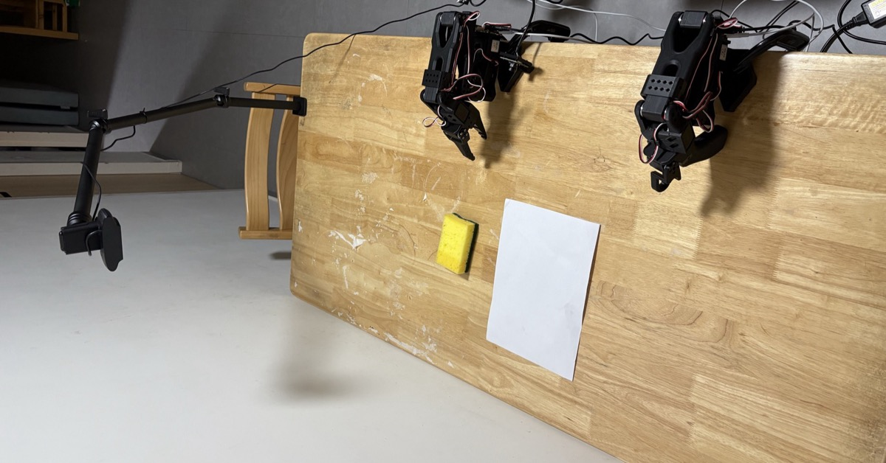
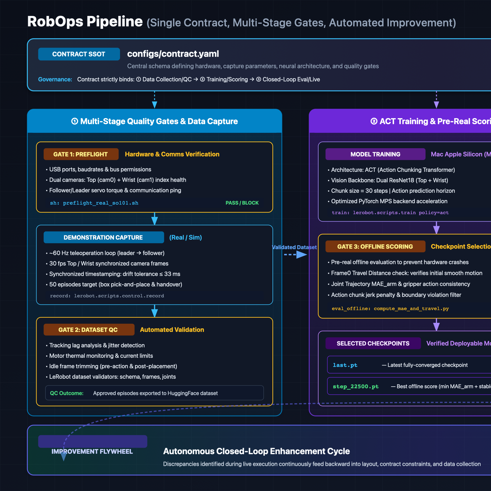
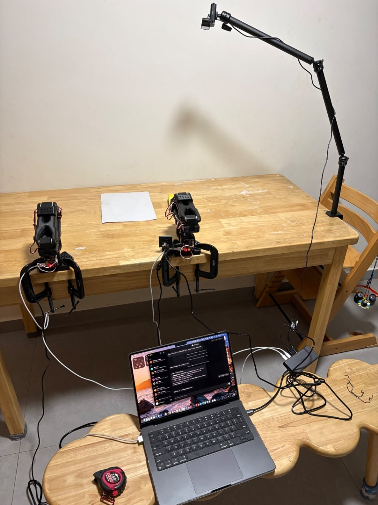
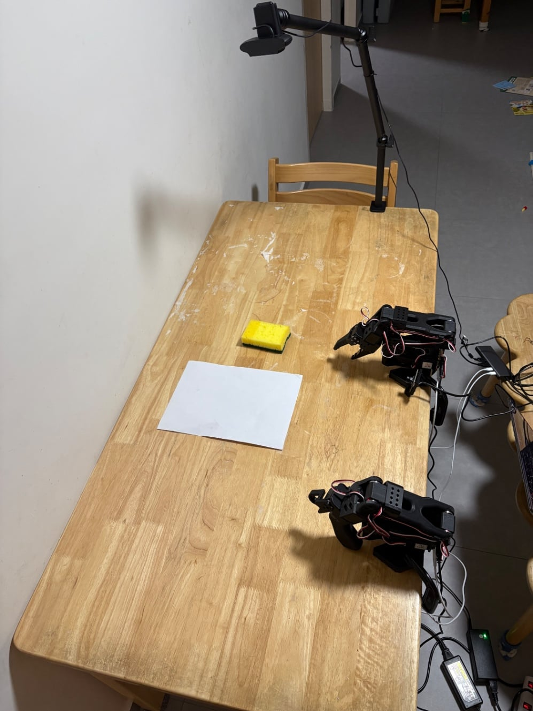

# From 0/16 to 3/3: nine stages of imitation learning on a desktop robot arm

## Introduction

I built this project as the final assignment for [Physical AI Applied 1](https://weblab.t.u-tokyo.ac.jp/lecture/course-list/physical-ai/advanced1/) at the UTokyo Matsuo-Iwasawa Lab. The course has finished and the assignment is submitted. The task was to use imitation learning on a small desktop robot arm to pick a sponge from a specified position with the gripper (the end effector that grabs objects), carry it onto a target sheet of paper, and set it down still. The deliverable was a working demo on the real robot.

I did not stop at simulation. I recorded datasets by teleoperating the real arm, trained a policy, and evaluated it on the real robot. This article records the problems I hit between bringing up the hardware and getting autonomous motion, and how I fixed them. The same write-up is also available in Japanese on [Zenn](https://zenn.dev/yohei/articles/2026-11-03-so101-sponge-paper-real-robot-walls).

My first live evaluation on the real robot scored 0/16 (0%). The arm trembled and stopped short of the target, or the gripper closed on nothing, again and again. It was a complete failure. The fixes were not only digital ones such as stricter simulation criteria and better model selection. I also changed the physical setup: a masking-tape frame on the desk, and interval cooling for the servo motors. After that, the final evaluation reached 3/3 successful grasp-and-place runs on the L2 evaluation set (verification set L2). With n=3, that is a reference point, not a benchmark. Qualitatively, the tremor was gone, and the arm approached the sponge smoothly and placed it still on the paper.

## Task and prerequisites

The task was pick-and-place: lift a sponge from the desk with the gripper, carry it onto a target sheet of paper, and place it gently. Getting stable autonomous motion on a physical device meant working with an ecosystem where hardware, machine learning, and a physics simulator all interact.

### Stack

- [SO-ARM101](https://huggingface.co/docs/lerobot/so101): a low-cost open-source 6-DoF desktop arm built from 3D-printed parts and serial bus servos.
- Leader/Follower pair: a person moves the leader arm by hand to demonstrate the motion, and the follower arm copies it in real time (see the [LeRobot teleoperation docs](https://huggingface.co/docs/lerobot/teleoperate)).
- [Imitation learning](https://en.wikipedia.org/wiki/Imitation_learning): supervised learning of an autonomous policy from time series of camera images and joint angles recorded during teleoperation.
- [LeRobot](https://github.com/huggingface/lerobot): the open-source framework from Hugging Face for training, inference, and dataset management in robotics.
- [ACT (Action Chunking with Transformers)](https://arxiv.org/abs/2304.13705): a Transformer policy that predicts several future steps (an action chunk) at once from past observations, which gives smooth trajectories.
- [MuJoCo](https://mujoco.org/): a fast physics simulator with accurate contact computation, widely used in robotics and reinforcement learning.
- Cameras: a Logicool C920 as the top camera, and the follower's gripper camera as the wrist camera.
- Training: a MacBook Pro (M4) with PyTorch MPS, 25,000 steps, about 3.5 to 4 hours. No cloud GPU.

### Public resources

All scripts and docs are public:

- Source code: [yohei1126/lerobot-so101-pick-and-place](https://github.com/yohei1126/lerobot-so101-pick-and-place)
- Docs: [project documentation](https://yohei1126.github.io/lerobot-so101-pick-and-place/)
- Demo video: [YouTube](https://youtu.be/hYQggz5CilA)

## Full path to a working demo

Reaching a working demo took a loop of operations from hardware wiring to evaluation and improvement, not only model training.

To speed up a robotics development cycle, the RobOps improvement flywheel in the figure has to keep turning: physical setup of the environment and jig, then data collection and quality control, then local training and model selection, then real-robot evaluation and problem finding. I ran that loop and removed one source of friction at a time.

I went through nine stages:

1. Hardware wiring and power: connect the leader and follower serial links to the PC, and supply 12V power safely to avoid under-powered servos and port mix-ups.
2. Desk layout standardization: measure the arm's range, camera framing, and object positions, and lay masking tape on the work mat to unify the physical coordinate system.
3. Preflight (ports + cameras) and framing checks: run a script that verifies serial ports, camera devices, and framing before teleoperation.
4. Teleoperation recording: record grasp-and-place demonstrations with the leader arm, with a cooling routine to limit servo heat and tracking lag.
5. Data QC: inspect plots of joint angles and camera video, and remove outlier trajectories and unneeded idle time before training.
6. Policy training (Mac MPS / ACT): train ACT on an Apple Silicon Mac without renting a cloud GPU.
7. Simulation evaluation: check the trained policy in MuJoCo with contact-based judging to narrow the gap to the real robot.
8. Checkpoint selection: choose weights using real-robot behavior and reach, not only validation loss.
9. Real-robot autonomous evaluation: run autonomous tests in the standardized setup, find the causes of tremor and missed grasps, and feed them back into the next loop.

## Problems and fixes by stage

For each stage, I describe what happened, what I changed, and the result.

### 1. Hardware wiring and power

I swapped the leader and follower serial ports, and I mixed up the 5V and 12V supplies. The control board LED lit up on USB bus power even when the 12V DC jack was not connected, so it looked powered when it was not. That false cue made it easy to believe the power connection was complete.

I plugged in one USB serial adapter at a time to fix the port names, and I labeled the physical cables. I turned the power-up sequence into a checklist and confirmed the 12V DC plug by eye and by pointing. The preflight script no longer guesses ports. It only checks whether the designated fixed ports connect.

That prevented startup communication errors from swapped ports and removed the servo errors caused by missing power.

### 2. Desk layout standardization

At the end of a motion, an arm joint touched the leg of the stand as the follower approached the target. Early in the project, I also changed the sponge and paper target dimensions several times, so the datasets no longer shared a coordinate system.

I redesigned the desk layout to keep clear of the arm's range of motion. I fixed one spec as the single source of truth: 140 mm from the arm base to the sponge center, and 70 mm from the arm base to the paper center. I laid masking tape on the work mat to mark a frame, which acted as a physical jig. The final layout series was layout39.

With the work area fixed to one set of dimensions, the contact between the arm and the stand stopped, and I could record reproducible data in a single coordinate system.

### 3. Preflight (ports + cameras) and framing checks

The device indices of the top camera (Logicool C920) and the wrist camera (on the follower's gripper) swapped often after OS reboots and USB replugs. On a Mac, Continuity Camera with an iPhone could also show up as a preferred device unintentionally and shift the camera indices.

I disabled the automatic phone camera handoff in the OS settings. I fixed the top camera 16 cm from the right front edge of the desk so the framing stayed constant. I also wrote a preflight script that checks the connection state of each USB serial port and the consistency of the camera indices. If an unexpected camera appears or an index does not match, it returns `FAIL` immediately and stops.

I run the preflight script before every session and do not start teleoperation or recording until it prints `RESULT: PASS`. That stopped me from throwing away data collected with a mismatched camera view. Voltage stayed on a visual pre-work checklist, because the script does not check it.

### 4. Teleoperation recording

After about 20 episodes in a row, the follower's `shoulder_lift` joint lagged its command by 10 to 12° instead of about 1.5°. I suspected that servo heat reduced the torque. The waiting time before each episode and extra motion after it also varied from episode to episode, which made the trajectories uneven.

I paused about every 10 episodes to let the servos cool down. I also standardized the procedure from the start of the leader arm motion to the end of grasp-and-place, and I fixed the wait times before and after each episode to one protocol.

Regular cooling kept the joint tracking lag from growing, and the demonstrations stayed consistent across the whole session.

### 5. Data QC

Recording sessions that I ran with `nohup` to keep them in the background ended abnormally. A relative path in the working directory also once made me append new episodes to an old dataset by mistake.

I moved recording to the foreground in an interactive terminal and stopped using `nohup`. Scripts now always use absolute paths for the dataset, and they stop if the target directory is missing or the metadata does not match.

I also built a QC tool that plots joint angles and camera video of recorded episodes to find outliers. Only data that passed QC went into training.

### 6. Policy training (Mac MPS / ACT)

My development machine was a MacBook Pro (M4), and I had no machine with an NVIDIA GPU. To avoid renting cloud GPU instances and uploading large video datasets each time, I kept recording, training, and checking on one Mac. I trained ACT with the PyTorch MPS (Metal Performance Shaders) backend.

The 25,000-step run took about 3.5 to 4 hours. macOS ships Bash 3.2 as the default shell, and its syntax limits broke parts of my scripts, such as associative arrays. I adjusted the scripts so they ran on the stock environment.

As a result, I could run the whole training loop on the local Mac without depending on the cloud.

### 7. Simulation evaluation

In MuJoCo, a box-snap shortcut (a simple rule that treats the object as grasped once it comes within a certain distance, like a magnet) counted trajectories as successes even when the real robot would not have grasped the object. That produced false-positive successes. The simulation also judged success by position within 25 mm and angle within 15°, while my real test was visual: grasp the sponge and set it down in the target area without dropping it. The two criteria did not match.

I removed box-snap from the simulation and judged success only by physical contact. I also revisited Temporal Ensembling (TE), which takes a weighted average of overlapping predicted action chunks to suppress sudden changes. With strong TE smoothing, plus the real arm's inertia and communication delay, the arm stalled short of the target. I adjusted the setting to suit the dynamics of the real arm.

The stricter simulation criteria narrowed the gap in behavior I saw when moving to the real robot.

### 8. Checkpoint selection

I loaded the checkpoint with the lowest validation loss (`val_l1`) onto the real arm. It trembled and did not extend far enough to reach the sponge, so the grasp never started. The model with the lowest L1 loss on validation data was not necessarily the best policy in real closed-loop control.

I stopped relying on `val_l1` alone. I picked candidates between 10,000 and 25,000 steps that had a decent success rate in offline simulation, ran each on the real robot, and narrowed them down step by step by how smoothly they reached the target coordinates. In the scoring comparison, `best_model` (the lowest `val_l1`) ranked 6th among all candidates.

That gave me a selection flow that takes real-robot stability into account instead of relying on the loss value.

### 9. Real-robot autonomous evaluation

My first live evaluation failed 16 times in a row, a result of 0/16. The main causes were arm tremor, short approaches, and a gripper that closed on nothing.

I re-ran the evaluation with the standardized final layout and the selected layout39 checkpoints. On the L2 evaluation set, the arm completed grasp-and-place 3 out of 3 times, and it was the first successful autonomous carry. With so few trials, the number is a reference value, not a benchmark. Still, the result moved clearly from complete failure to autonomous success.

## If you try the same thing

These are the lessons for anyone starting imitation learning on a desktop arm, in stage order:

- Do not teleoperate or record while preflight shows `FAIL`. Data collected with a shifted camera index or a wrong port is wasted.
- Turn off automatic phone camera handoff in the OS settings, for example Continuity Camera between a Mac and an iPhone. This prevents unintended camera priority changes.
- Rest the servos about every 10 episodes. Short cooling cycles were necessary to avoid joint tracking lag from motor heat.
- Avoid `nohup` for recording, and use absolute paths. This avoids abnormal exits from lost input and writes to the wrong directory.
- Do not move hardware to match old drawings or memory. Use the taped jig, based on the measured spec, as the only reference.
- Dry-run before powering up, and keep the 12V plug within reach so you can cut power at once if the arm collides or a servo runs away.
- Do not discard an episode only because it has a still period at the start or end. These periods can help stabilize the policy, so if the episode follows the protocol, there is no need to delete it in a hurry.
- Do not pick checkpoints by `val_l1` alone. In real closed-loop control, the lowest-loss model often failed to reach the target. Check behavior on the real robot or in a physics simulator too.

## Closing

On a small robot arm, standardizing the physical environment (power, ports, jig layout, heat management) mattered about as much as choosing the model.

Everything is public. Clone the [repository](https://github.com/yohei1126/lerobot-so101-pick-and-place), read the bring-up steps in the [docs](https://yohei1126.github.io/lerobot-so101-pick-and-place/), try a dry-run on your desk, and watch the [demo video](https://youtu.be/hYQggz5CilA). The hardware is described in the [LeRobot SO-101 docs](https://huggingface.co/docs/lerobot/so101). The Japanese version is on [Zenn](https://zenn.dev/yohei/articles/2026-11-03-so101-sponge-paper-real-robot-walls).
